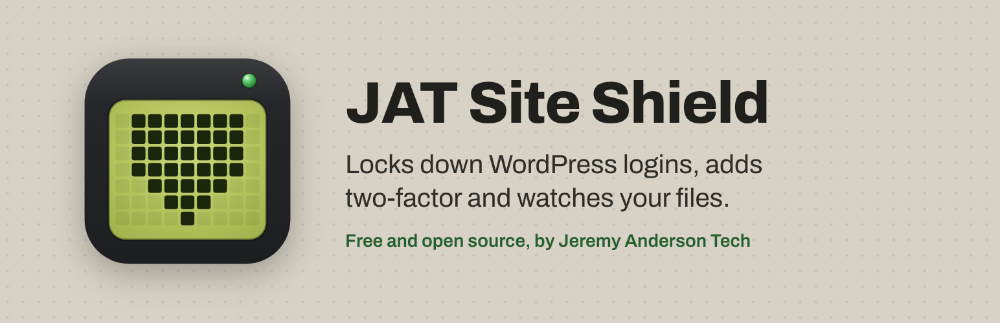
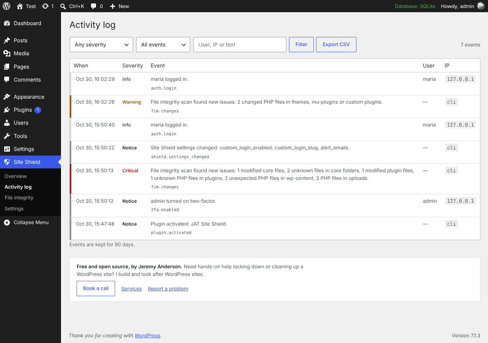
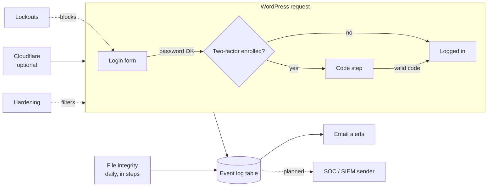

<div align="center">



# JAT Site Shield

**Lock WordPress down: login lockouts, two-factor codes, core hardening, an activity log with email alerts, and file integrity checks. One plugin, safe defaults, no account.**

[](https://github.com/CptNope/JAT-Site-Shield/actions/workflows/ci.yml)


[](LICENSE)

**Version 1.0.0** · [Changelog](CHANGELOG.md) · [Roadmap](ROADMAP.md) · [Free Cloudflare setup guide](docs/cloudflare.md)

Free · no paid version · no sign-up · nothing sent to us

By [Jeremy Anderson Tech](https://jeremyanderson.tech/) · Pairs with [JAT Shell Scanner](https://github.com/CptNope/JAT-Shell-Scanner) · [Need hands-on help? Book a call](https://jeremyanderson.tech/book-a-call/)

</div>

> [!TIP]
> **Site Shield keeps attackers out; [JAT Shell Scanner](https://wordpress.org/plugins/jat-shell-scanner/) checks whether one already got in.** Use both on every site you look after.

---

## Contents

- [What it does](#what-it-does)
- [Screenshots](#screenshots)
- [Requirements](#requirements)
- [Install](#install)
- [Recommended setup for a client site](#recommended-setup-for-a-client-site)
- [Cloudflare](#cloudflare)
- [If you get locked out](#if-you-get-locked-out)
- [WP-CLI](#wp-cli)
- [How it works](#how-it-works)
- [For developers](#for-developers)
- [Privacy and external services](#privacy-and-external-services)
- [Known limits](#known-limits)
- [Roadmap](#roadmap)
- [Contributing, support and security](#contributing-support-and-security)
- [License and credits](#license-and-credits)

## What it does

| Area | Protection |
|---|---|
| **Login** | Locks out an IP after repeated failed logins, with longer lockouts for repeat offenders. IPv6 addresses are grouped by /64. Login and password-reset forms give the same answer whether or not an account exists. Optional custom login address: `wp-login.php`, `wp-signup.php` and `/wp-admin` return "Not Found" to logged-out visitors. |
| **Two-factor** | Six-digit codes from any authenticator app (1Password, Google Authenticator, Microsoft Authenticator, Authy) plus 10 single-use backup codes. Required per role (administrators by default); people in required roles must enroll before they can use the dashboard, REST API or AJAX. Every login session records that it passed two-factor, so plugins that log people in directly can't skip it. Secrets are encrypted with a key kept outside the database. |
| **Hardening** | Blocks XML-RPC (left on automatically if Jetpack needs it), username scanning (`?author=`, REST `/users`, oEmbed, users sitemap), the theme and plugin file editor, and PHP in uploads, with a one-click test that it works. Sends security headers and hides the WordPress version without breaking cache busting. Optional HSTS and application-password switch-off. |
| **Activity log** | Logins, failed logins, lockouts, two-factor events, new users and role changes, email and password changes, plugin and theme installs, updates and activations, core updates, and changes to key settings such as `siteurl` and `admin_email`. Filter, search and export to CSV. |
| **Alerts** | Emails critical events (or warnings too) to the addresses you choose, at most 10 an hour. A **Send a test alert** button checks email actually arrives. |
| **File integrity** | A daily scan compares core and every WordPress.org plugin with the official checksums. Themes, must-use plugins and plugins from elsewhere are compared with the previous scan. Flags modified files, unknown PHP files, PHP in uploads (hidden folders included) and stray PHP in `wp-content`. Runs in small steps so large sites don't time out. |
| **Checklist** | One verdict for the site plus a checklist that catches common mistakes: no HTTPS, Cloudflare's Flexible SSL, an `admin` username, `WP_DEBUG` showing errors, WP-Cron turned off, and a two-factor key that can't be stored safely. |

## Screenshots

| | |
|---|---|
|  |  |
|  |  |
|  |  |

## Requirements

- WordPress 6.4 or newer
- PHP 7.4 to 8.4 (tested in CI on 7.4, 8.0, 8.1, 8.2, 8.3 and 8.4)
- Single sites. Multisite works, but the custom login address is turned off there.

## Install

1. In WordPress, go to **Plugins → Add New**, search for "JAT Site Shield", then install and activate it. Until the directory listing is live, download `jat-site-shield.zip` from [Releases](https://github.com/CptNope/JAT-Site-Shield/releases) (or build it with `bash bin/build-zip.sh`) and use **Upload Plugin**.
2. You'll be asked to set up two-factor for your administrator account. Scan the QR code, enter the code, and save your backup codes in your password manager.
3. Open **Site Shield → Overview** and work through anything on the checklist that isn't green.

Updates come through the WordPress.org plugin directory like any other plugin.

## Recommended setup for a client site

1. Activate and enroll in two-factor yourself.
2. **Settings → Login protection:** turn on **Move the login page**, pick an address that isn't easy to guess, and save. Bookmark it and put it in your password manager.
3. **Settings → Hardening:** click **Test it now** under "Block PHP in the uploads folder". If PHP still runs, the server ignores `.htaccess` (nginx); ask the host to block PHP in `wp-content/uploads`.
4. **Settings → Monitoring and alerts:** add your agency's alert address, then **Send a test alert**.
5. Put the site behind Cloudflare's free plan with the [free Cloudflare setup guide](docs/cloudflare.md).
6. Run a file integrity scan and accept anything that's expected.

**Things to know**

- **Back up the two-factor key.** Secrets are encrypted with `wp-content/jatss-key.php`, created on activation. Include it in backups and migrations; if it's lost, every user's two-factor must be reset. On sites with several servers, or a read-only `wp-content`, put `define( 'JATSS_SECRET_KEY', '…at least 32 random characters…' );` in `wp-config.php` before anyone enrolls.
- **Visitor login links.** The custom login address is only shown to people already on the login page or logged in. Login links a theme shows to logged-out visitors ("Log in to reply") keep pointing at `wp-login.php` and return "Not Found". On membership sites, link to the new address yourself or leave this feature off.

## Cloudflare

Site Shield detects Cloudflare by itself and reads real visitor IPs from Cloudflare's header, but only when the request really comes from [Cloudflare's network](https://www.cloudflare.com/ips/), so the header can't be faked. **Settings → Network** shows what every IP source reports and which one Site Shield uses.

The **[free Cloudflare setup guide](docs/cloudflare.md)** walks through SSL Full (strict), locking your server to Cloudflare, five firewall rules, the free rate-limiting rule, bot settings, and caching without breaking logins.

## If you get locked out

| Problem | Fix |
|---|---|
| Forgot the custom login address | `wp jat-shield login-url`, or see the next rows. |
| Lost your phone and backup codes | Another administrator resets your two-factor from your profile, or `wp jat-shield reset-2fa <user>`. |
| Locked out of everything | Add `define( 'JATSS_SAFE_MODE', true );` to `wp-config.php`. This pauses the custom login address, two-factor and lockouts; logging and hardening stay on. Remove it once you're back in. |
| Your own IP is locked out | Wait, run `wp jat-shield unlock <ip>`, or add your office IP to **Never lock out**. |
| Everyone is locked out at once | Visitors probably share one proxy IP. See [Cloudflare](#cloudflare), then `wp jat-shield unlock all`. |
| Nothing else works | Rename `wp-content/plugins/jat-site-shield` over SFTP to deactivate it. |

## WP-CLI

```bash
wp jat-shield status              # checklist of protections
wp jat-shield login-url           # print the custom login address
wp jat-shield lockouts            # list locked-out IPs
wp jat-shield unlock <ip|all>     # lift lockouts (IPv6 /64 ranges too)
wp jat-shield reset-2fa <user>    # remove a user's two-factor
wp jat-shield scan [--all]        # run a file integrity scan now
wp jat-shield log [--severity=warning] [--count=50] [--format=json]
```

## How it works



Every event goes through one function, `JATSiteShield\Event_Log::log()`, which fires `jatss_event_logged`. The planned SOC connection hooks that action; nothing else has to change.

| Severity | Examples | Emailed by default |
|---|---|---|
| `critical` | New administrator, admin email or site address changed, Site Shield deactivated, modified core PHP file, PHP in uploads, correct password but repeated two-factor failures, a session that skipped two-factor | Yes |
| `warning` | IP lockout, new plugin installed, user deleted, two-factor reset, protections switched off | Optional |
| `notice` | Administrator logins, plugin activated, two-factor turned on | No |
| `info` | Failed logins, blocked probes (logged at most once an hour per IP, capped per hour) | No |

## For developers

| Hook | Type | Use |
|---|---|---|
| `jatss_event_logged` | action | Receives every stored event as an array. |
| `jatss_xmlrpc_needed` | filter | Return `true` to keep XML-RPC on for a plugin that needs it. |
| `jatss_session_requires_2fa` | filter | Return `false` for logins from a single sign-on plugin you trust to do its own second factor. Receives `$required`, `$user_id`, `$session`. |
| `jatss_cloudflare_ranges` | filter | Override Cloudflare's IP ranges if they change before the plugin is updated. |

| Constant | Use |
|---|---|
| `JATSS_SAFE_MODE` | `true` pauses the custom login address, two-factor and lockouts. |
| `JATSS_SECRET_KEY` | Your own two-factor encryption key (at least 32 characters) instead of `wp-content/jatss-key.php`. |

## Privacy and external services

The activity log stores IP addresses, user agents and usernames for security events in your own database, for 90 days by default. Nothing is sent to Jeremy Anderson Tech. The only outside requests are the file integrity scan's downloads of official checksums from WordPress.org: your WordPress version and language for core, and each plugin's slug and version. See [readme.txt](readme.txt) for the full disclosure.

## Known limits

- **Logins over the REST API** (JWT plugins) aren't supported for users with two-factor; use application passwords.
- **Lockouts are stored as transients.** On several servers, use a shared object cache (Redis or Memcached) for lockouts to apply everywhere.
- **The file check needs WP-Cron.** On quiet sites, or with `DISABLE_WP_CRON`, add a server cron job for `wp-cron.php`.
- **PHP-in-uploads blocking** is written as `.htaccess` (Apache and LiteSpeed). On nginx, ask the host, or use the Cloudflare rule in the guide.

## Roadmap

Next up: vulnerability alerts for installed plugins, re-confirming two-factor before dangerous actions, and passkeys. See **[ROADMAP.md](ROADMAP.md)** for the full plan and what's deliberately out of scope.

## Contributing, support and security

- **Questions and help:** see [SUPPORT.md](SUPPORT.md).
- **Bugs and ideas:** [open an issue](https://github.com/CptNope/JAT-Site-Shield/issues/new/choose).
- **Code:** see [CONTRIBUTING.md](CONTRIBUTING.md). `main` is protected; changes go through pull requests with passing CI.
- **Security problems:** report them privately, never in a public issue. See [SECURITY.md](SECURITY.md).

Everyone taking part is expected to follow the [code of conduct](CODE_OF_CONDUCT.md).

## License and credits

GPL-2.0-or-later. See [LICENSE](LICENSE). The bundled QR code library is [qrcode-generator](https://github.com/kazuhikoarase/qrcode-generator) by Kazuhiko Arase (MIT).

Built by Jeremy Anderson of [Jeremy Anderson Tech](https://jeremyanderson.tech/): WordPress development, security hardening and AI tools. [Services](https://jeremyanderson.tech/services/) · [Book a call](https://jeremyanderson.tech/book-a-call/)
