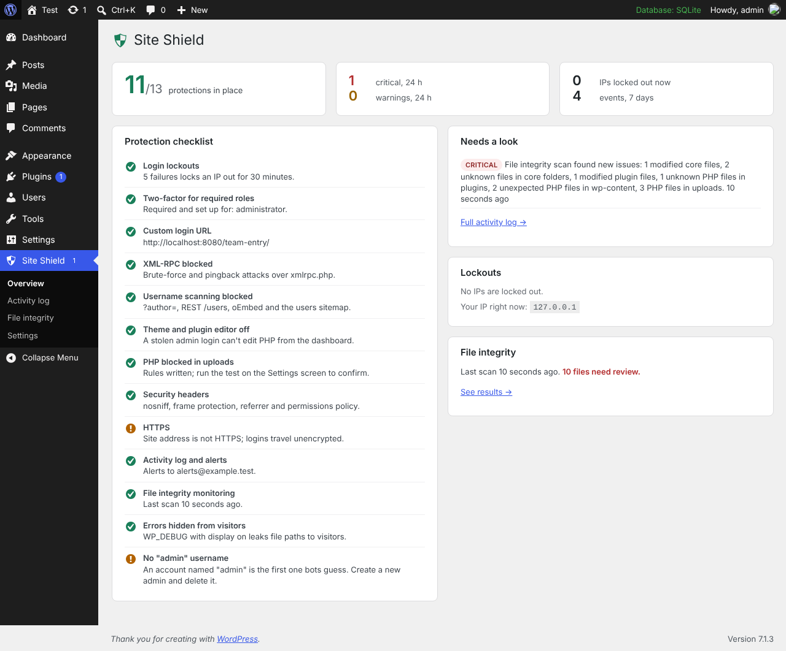
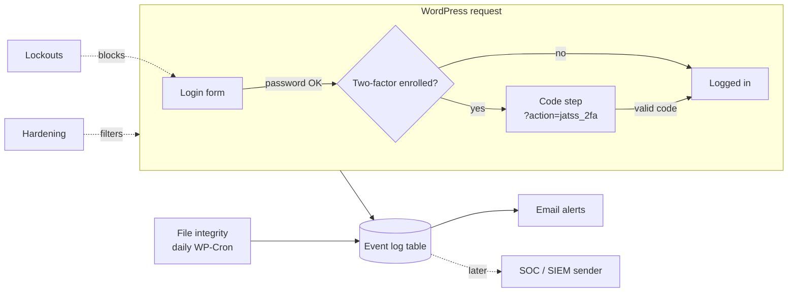
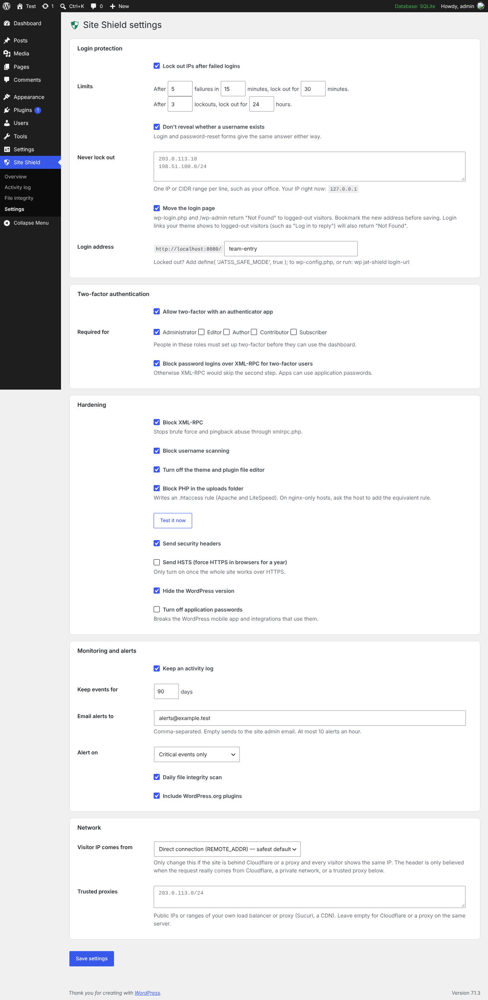
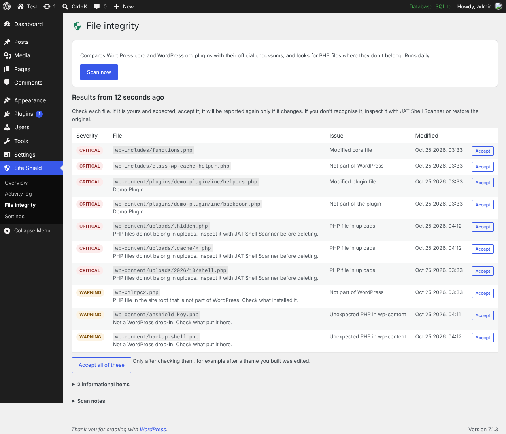
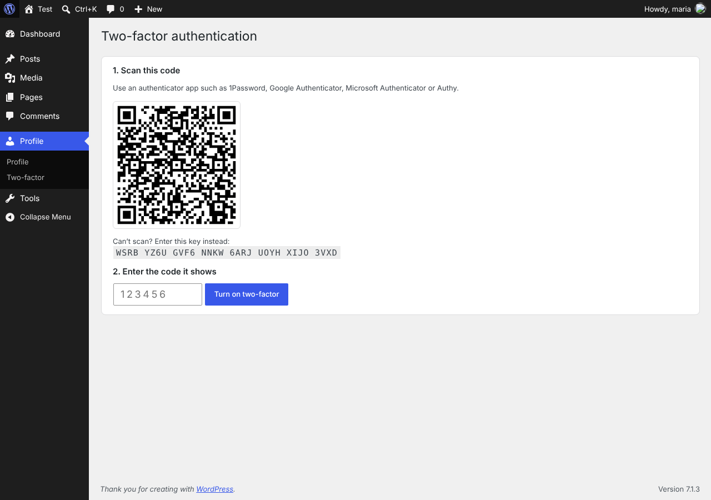
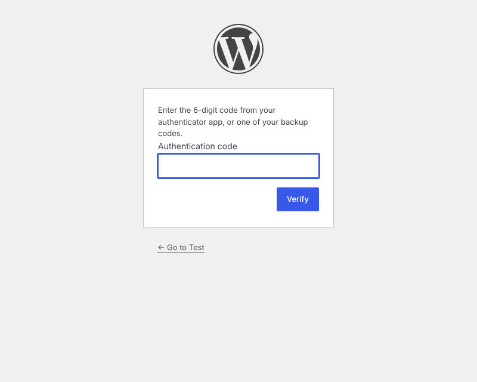

# JAT Site Shield

A WordPress security plugin that locks a site down and keeps a record of what happens on it. It's built for agencies that run many client sites: one plugin, sensible defaults, and nothing that needs an outside service.



## What it does

| Area | Protection |
|---|---|
| **Login** | Locks out an IP after repeated failed logins, with longer lockouts for repeat offenders. Login and password-reset forms give the same answer whether or not an account exists. Optional custom login address: `wp-login.php` and `/wp-admin` return "Not Found" to logged-out visitors. |
| **Two-factor** | TOTP codes from any authenticator app (1Password, Google Authenticator, Microsoft Authenticator, Authy) plus 10 single-use backup codes. Required per role (administrators by default); people in required roles must enroll before they can use the dashboard, REST API or AJAX. Every login session records that it passed two-factor, so plugins that log people in directly (social login, magic links) can't skip it. Secrets are encrypted with a key kept outside the database (see below), so a database leak alone doesn't reveal them, and rotating the WordPress salts doesn't break them. |
| **Hardening** | Blocks XML-RPC (left on automatically if Jetpack needs it), username scanning (`?author=`, REST `/users`, oEmbed, users sitemap), the theme and plugin file editor, and PHP execution in uploads. Sends security headers and hides the WordPress version. Optional HSTS and application-password switch-off. |
| **Activity log** | Logins, failed logins, lockouts, two-factor events, new users and role changes, email and password changes, plugin and theme installs, updates and activations, core updates, and changes to key settings like `siteurl` and `admin_email`. Filter, search and export to CSV. |
| **Alerts** | Emails critical events (or warnings too) to the addresses you choose, capped at 10 an hour so an attack can't flood an inbox. |
| **File integrity** | Daily scan against the official WordPress.org checksums for core and every WordPress.org plugin. Themes, mu-plugins and plugins from elsewhere are compared with the previous scan instead (a fresh baseline is taken after each update). Flags modified files, unknown PHP files, PHP in uploads (hidden folders included) and stray PHP in `wp-content`. Runs in steps on WP-Cron so large sites don't time out. |

## Requirements

- WordPress 6.4 or newer
- PHP 7.4 or newer
- Single-site installs. It runs on multisite, but the custom login address is turned off there.

## Install

1. In WordPress, go to **Plugins → Add New**, search for "JAT Site Shield", then install and activate it. (Or download `jat-site-shield.zip` from the [latest release](https://github.com/CptNope/Anderson-Site-Shield/releases/latest) and use **Upload Plugin**.)
2. You'll be asked to set up two-factor for your administrator account. Scan the QR code, enter the code, and save your backup codes in your password manager.
3. Open **Site Shield → Overview** and work through anything on the checklist that isn't green.

Updates come through the WordPress.org plugin directory like any other plugin.

### Recommended setup for a client site

1. Activate and enroll in two-factor yourself.
2. **Settings → Login protection:** turn on **Move the login page**, pick an address that isn't guessable, and save. Bookmark the new address and put it in your password manager.
3. **Settings → Hardening:** click **Test it now** under "Block PHP in the uploads folder". If it says PHP still runs, the server ignores `.htaccess` (nginx); ask the host to block PHP in `wp-content/uploads`.
4. **Settings → Monitoring:** put your agency's alert address in **Email alerts to**.
5. If the site is behind Cloudflare, set **Visitor IP comes from** to Cloudflare (the plugin warns you if it notices Cloudflare). The header is only believed from Cloudflare's own addresses, so it can't be faked. For another proxy or load balancer, add its addresses under **Trusted proxies**.
6. Run a file integrity scan and accept anything that's expected.

### Things to know

- **The two-factor key.** Secrets are encrypted with `wp-content/jatss-key.php`, created on activation. Include it in backups and migrations. If it's lost, every user's two-factor must be reset (`wp jat-shield reset-2fa <user>`). To manage the key yourself, put `define( 'JATSS_SECRET_KEY', '…64 random characters…' );` in `wp-config.php` before anyone enrolls.
- **Custom login address and visitor links.** The new address is only shown to people already on the login page or logged in. Login links a theme shows to logged-out visitors ("Log in to reply", a Meta widget) keep pointing at `wp-login.php` and return "Not Found". If a site's visitors need to log in (a membership site), link to the new address yourself, or leave this feature off.

## If you get locked out

| Problem | Fix |
|---|---|
| Forgot the custom login address | Run `wp jat-shield login-url`, or see the next row. |
| Lost your phone and backup codes | Another administrator can reset your two-factor from your profile, or run `wp jat-shield reset-2fa <user>`. |
| Locked out of everything | Add `define( 'JATSS_SAFE_MODE', true );` to `wp-config.php`. This pauses the custom login address, two-factor and lockouts (logging and hardening stay on). Remove it once you're back in. |
| Your own IP is locked out | Wait for the lockout to end, run `wp jat-shield unlock <ip>`, or add your office IP to **Never lock out**. |
| Nothing else works | Rename `wp-content/plugins/jat-site-shield` over SFTP. That deactivates it. |

## WP-CLI

```bash
wp jat-shield status              # checklist of protections
wp jat-shield login-url           # print the custom login address
wp jat-shield lockouts            # list locked-out IPs
wp jat-shield unlock <ip|all>     # lift lockouts
wp jat-shield reset-2fa <user>    # remove a user's two-factor
wp jat-shield scan [--all]        # run a file integrity scan now
wp jat-shield log [--severity=warning] [--count=50] [--format=json]
```

## How the pieces fit



Every event goes through one function, `JATSiteShield\Event_Log::log()`, which fires the `jatss_event_logged` action. Sending events to a central SOC/SIEM later means hooking that action; nothing else has to change.

### Event severities

| Severity | Examples | Emailed by default |
|---|---|---|
| `critical` | New administrator, admin email or site URL changed, this plugin deactivated, modified core PHP file, PHP in uploads, correct password but repeated 2FA failures | Yes |
| `warning` | IP lockout, new plugin installed, user deleted, 2FA reset, protections switched off | Optional |
| `notice` | Admin logins, plugin activated, 2FA turned on | No |
| `info` | Failed logins, blocked probes (logged at most once an hour per IP) | No |

## Hooks for developers

| Hook | Type | Use |
|---|---|---|
| `jatss_event_logged` | action | Receives every stored event as an array. |
| `jatss_xmlrpc_needed` | filter | Return `true` to keep XML-RPC on for a plugin that needs it. |

## Screenshots

| | |
|---|---|
|  |  |
|  |  |

## Development

```bash
bash bin/build-zip.sh   # builds dist/jat-site-shield.zip
```

To release, bump the version in `jat-site-shield.php` (header and `JATSS_VERSION`) and the `Stable tag` in `readme.txt`, add a changelog entry, then push a tag like `v1.0.1`. The release workflow builds the zip, attaches it to a GitHub release and, once `SVN_USERNAME` and `SVN_PASSWORD` secrets are set, publishes it to WordPress.org with the directory assets in `.wordpress-org/`.

## License

GPL-2.0-or-later. The bundled QR code library is [qrcode-generator](https://github.com/kazuhikoarase/qrcode-generator) by Kazuhiko Arase (MIT).

Built by Jeremy Anderson of [Jeremy Anderson Tech](https://jeremyanderson.tech/): WordPress development, security hardening and AI tools. [Services](https://jeremyanderson.tech/services/)
